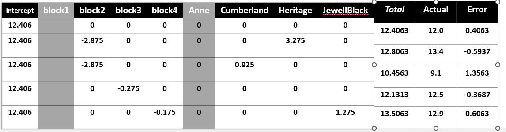
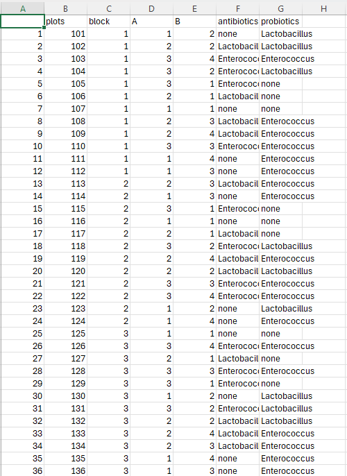

# Question 1:

```{r}
malting <- read.csv("../data/16_malting.csv")

malting
```

The malting dataset appears to be one RCBD with multifatorial.

## ANOVA

### AOV

```{r}
aovmalting <- aov(data = malting, malt_quality ~ block + density * depth)
summary(aovmalting) 

```

### ANOVA

```{r}
anova(aovmalting)
```

Results are same, just a matter of rounding decimals.

All factors are significant, blocks, density, depth and the interaction between them.

### Plotting interaction in two different ways.

```{r}

interaction.plot(x.factor = malting$density,
                 trace.factor = malting$depth,
                  response = malting$malt_quality
                  )

```

```{r}
interaction.plot(x.factor = malting$depth,
                 trace.factor = malting$density,
                  response = malting$malt_quality
                  )
```

# Question 2



# Question 3

```{r}
pecans <- read.csv("../data/16_pecans.csv")

pecans
```

```{r}
model_pecan <- lm(percent_scab ~ block + variety * fungicide, data = pecans)
summary(model_pecan)


```

```{r}
hist(pecans$percent_scab)
plot(pecans$percent_scab, pch = 20, cex = 1.5)
```

```{r}
hist(residuals(model_pecan))
plot(residuals(model_pecan), pch = 20, cex = 1.5)
```

```{r}
library(gvlma)

gvlma(model_pecan)

```

```{r}
pecans$residuals <- residuals(model_pecan)

pecans$percent_scab[pecans$residuals > 15] = NA

pecans
```

```{r}
model_clean <- lm(data = pecans, percent_scab ~ block + fungicide * variety)
summary(model_clean)
```

```{r}
gvlma(model_clean)
```

```{r}
plot(residuals(model_clean))
hist(residuals(model_clean), pch = 20, cex = 1.5)

```

# Exercise 4

```{r}
beans <- read.csv("../data/16_beans.csv")

beans
```

```{r}
plot(beans$disease)
hist(beans$disease, pch = 20, cex = 1.5)
```

Since we are looking for the interaction genotype x inoculant we need type 3

```{r}
library(car)
library(agricolae)


options(contrasts = c("contr.sum", "contr.poly"))

model_beans <- aov(disease ~ block + variety * inoculant, data = beans) # Block first following convention
summary(model_beans)

tukey_beans_genotype <- HSD.test(model_beans, trt = "variety")
tukey_beans_genotype

tukey_beans_inoculant <- HSD.test(model_beans, trt = "inoculant")
tukey_beans_inoculant
```

Better are genotypes PZ076, Abel21 with no significant difference for M91 but with different value. For inoculants Supergrow is the best onw with no significant difference for NitroTastic that shares same group. I'm assuming this classification is "The lower the better"


# Exercise 5

Best design will be a multi-fatorial RCBD.

```{r message=FALSE, warning=FALSE}
library(dplyr)

set.seed(0)

antibiotics <- c("none","Tetracycline","Lincomycin")

probiotics <- c("none","Lactobacillus","Enterococcus","Bifidobacteria")
  
# https://cran.r-project.org/web/packages/agricolae/vignettes/tutorial.pdf (Page 23) 

design <- design.ab(
  trt = c(3,4), # First start the columns then change to the actual contents
  r = 3,
  randomization = TRUE
)

fieldbook <- design$book

field_book <- fieldbook %>%
  mutate( A = as.integer(A),
          B = as.integer(B))

exp_design <- field_book %>%
  mutate(antibiotics = probiotics[A],
         probiotics = antibiotics[B])

write.csv(exp_design,file = "../output/06_Homework.csv")

exp_design

```

Blocs are barns, so 3 -1 = 2 DOF, Antibiotics 3 - 1 = 2 DOF and Probiotics 4 - 1 = 3 DOF P x A (Interaction) = 6 DOF Total 3 x 3 x 4 = 36 (Experimental Units) - 1 = 35 DOF Error = 35 - 6 (Interaction) - 2 (Block) - 2 (Antib) - 3 (Prob) = 22 DOF of error.

Opening on outside software.


