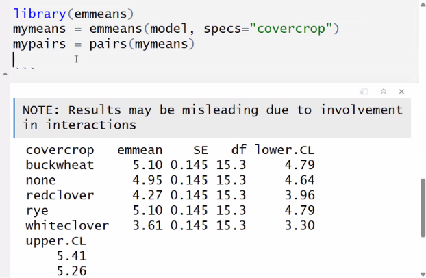

Practical analysis.

# Review on Augmented designs.

```{r}
bermuda <- read.csv("../data/21_bermuda.csv")

bermuda
```

```{r}
library(lmerTest)

mymodel <- lmer(persistence ~ (1|variety) + (1|field) + (1|block), data = bermuda)

anova(mymodel)
ranova(mymodel)
```

```{r}
table(bermuda$field, bermuda$block)
```

```{r}
mymodel2 <- lmer(persistence ~ (1|variety) + (1|block), data = bermuda)
ranova(mymodel2)

```



This is do the same of Tukey, but warning that this results can lead to some misinterpretations.
